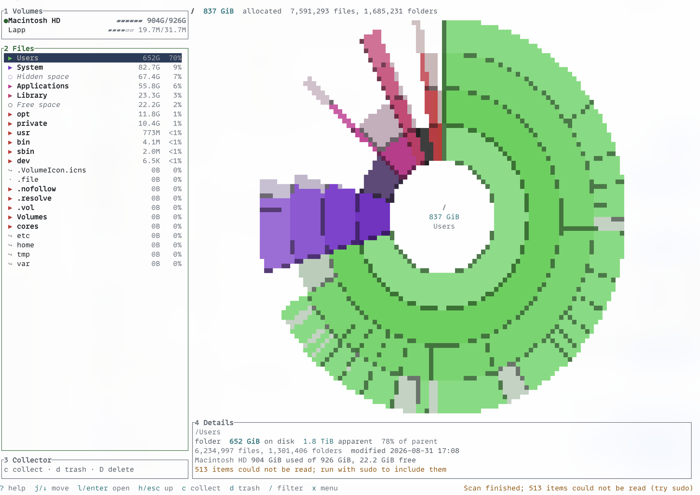
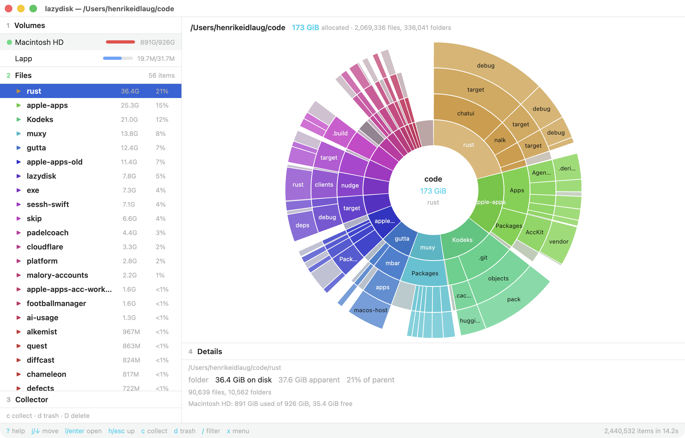

# lazydisk

A keyboard-driven disk space analyzer for macOS (and Linux) written in Rust.
It shows what is using your disk as a sunburst map and lets you browse, collect
and delete with single-key commands. Inspired by
[lazygit](https://github.com/jesseduffield/lazygit) and
[DaisyDisk](https://daisydiskapp.com).



Two frontends share one core:

| Crate | What |
|---|---|
| `lazydisk-core` | parallel scanner (`dua-core`), size tree, sunburst geometry, keyboard state machine, file operations |
| `lazydisk-tui` | the `lazydisk` terminal app (ratatui) |
| `lazydisk-gpui` | the `lazydisk-desktop` window app (gpui-ce), same keys plus mouse, hover and native menus |

## Install and run

Requires Rust 1.95 or newer.

```sh
cargo install --path crates/lazydisk-tui
lazydisk            # scan the current directory
lazydisk ~          # scan your home folder
lazydisk /          # scan the whole startup volume (hidden space is shown)
sudo lazydisk /     # include folders your user cannot read
lazydisk --help
```

### Desktop app

```sh
cargo run --release -p lazydisk-gpui -- ~        # needs Xcode (Metal) on macOS
```

The desktop window has the same panels and keys as the terminal app. Hovering a petal
selects it, clicking a folder opens it, clicking the centre goes up, scrolling over the
sunburst moves up and down, and the File and Go menus carry the usual macOS shortcuts
(⌘O open folder, ⇧⌘R rescan, ⌘[ ⌘] history, ⌘↑ enclosing folder, ⌘⌫ move collected to Trash).



## Using it

The screen has four numbered panels; press the number or `tab` to focus one.

- **Files** lists the children of the folder in the centre of the sunburst, largest first.
  `j`/`k` move, `l`/`enter` opens a folder, `h`/`esc` goes up, `[`/`]` move through history,
  `/` filters by name.
- **Sunburst** shows the same folder: ring 1 is its children, ring 2 their children and so on.
  Folders are coloured, files grey, unreadable folders purple, and siblings too thin to draw
  are merged into a pale "smaller objects" petal. `+`/`-` change the number of rings.
  Click a petal to select it, click again to open it, click the centre to go up.
- **Collector** holds what you intend to delete. `c` adds or removes the selected item,
  `d` moves everything collected to the Trash after a `y`/`n` prompt, `D` deletes permanently
  after you type `DELETE`. System folders, mount points and your home folder are refused.
- **Details** describes the selected item: size on disk, apparent size, share of its parent,
  counts, modification time and flags such as hard link or APFS clone.
- `o` reveals the item in Finder, `space` opens Quick Look, `y` copies its path, `x` opens a
  context menu, `s` toggles allocated/apparent size, `r`/`R` rescan, `?` shows every key.

The full keymap is in [docs/KEYMAP.md](docs/KEYMAP.md). Rebind anything in
`~/.config/lazydisk/config.toml`; `lazydisk --print-config` prints a commented example.

## How sizes are computed

- Default is **allocated** size (blocks on disk, like `du`). `s` or `--apparent` switches to
  logical file lengths.
- Hard links are counted once. On APFS, clone families (`cp -c`, Finder duplicates, Time
  Machine) are counted once too, using the clone identifier the filesystem reports.
  The duplicates are kept in the tree with size 0 and a flag so you can still find them.
- Scans stay on one filesystem. Scanning `/` on macOS also follows the Data volume through
  its firmlinks, and skips `/System/Volumes/Data` itself so nothing is counted twice.
- When the scan root is a mount point, **Hidden space** is the difference between what the
  volume reports as used and what was scanned: purgeable space, other APFS volumes in the
  container, folders you may not read, and filesystem overhead.

## Known limits

- Purgeable space and snapshots are not itemised yet; they appear inside Hidden space.
- Admin scans mean running with `sudo`; there is no in-app privilege prompt.
- Cloud storage is not scanned remotely.
- Linux builds compile and scan, but Finder/Quick Look integration is macOS only.
- `gpui-ce` 0.3.0 holds its platform lock while running the startup closure on macOS, so the
  desktop app defers all setup to the first foreground task (see `crates/lazydisk-gpui/src/main.rs`).

## Development

```sh
scripts/check.sh                         # fmt, clippy -D warnings, tests, docs freshness
cargo run -p lazydisk-tui -- ~/Library   # run the terminal app against a real folder
cargo run -p lazydisk-gpui -- ~/Library  # run the desktop app
cargo run --release -p lazydisk-core --example scan -- ~/Library   # scanner benchmark
```

Architecture, milestones and research notes are in [docs/PLAN.md](docs/PLAN.md).
